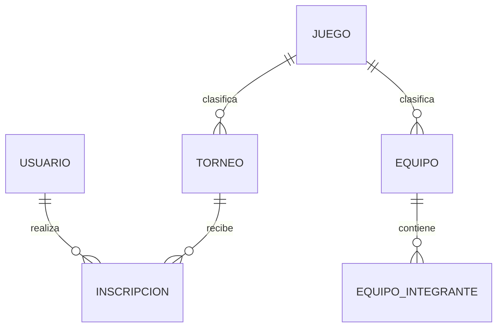

# Especificación de requisitos de software

## Propósito y alcance

eSports Arena Manager permite publicar torneos de videojuegos, administrar equipos e inscribir jugadores. La solución se compone de un frontend React/Vite y una API Spring Boot conectada a una base de datos relacional. El sistema de ejemplo no representa una tienda; los modelos Pokémon y GameHub de los anexos no pertenecen al dominio funcional de este proyecto.

## Actores y permisos

| Actor | Permisos |
|---|---|
| Visitante | Ver inicio, catálogo de juegos, listado y detalle de torneos; crear una cuenta e iniciar sesión. |
| Jugador | Permisos de visitante e inscripción propia a torneos abiertos. |
| Organizador | Crear, consultar, actualizar y eliminar torneos y equipos. |
| Administrador | Permisos de organizador; consultar usuarios y asignar roles. |

La API valida roles en el servidor. Ocultar rutas en el frontend mejora la navegación, pero no reemplaza la autorización del backend.

## Requisitos funcionales

1. El usuario debe poder crear una cuenta como jugador e iniciar sesión con correo y contraseña.
2. El sistema debe emitir JWT de acceso y refresh token al autenticar.
3. El usuario autenticado debe poder consultar su sesión, cerrar sesión en el frontend y renovar la sesión antes de que expire el JWT.
4. Los visitantes deben consultar juegos y torneos sin autenticación.
5. Los organizadores y administradores deben administrar torneos y equipos; el backend valida los juegos, integrantes, capitanes y referencias a inscripciones.
6. El jugador debe inscribirse una sola vez por torneo, dentro del plazo y mientras queden cupos. La participación puede ser individual para juegos `1v1` o mediante equipo activo compatible para juegos por equipo.
7. El administrador debe consultar usuarios y asignar roles válidos.
8. La API debe describir sus rutas y modelos en Swagger/OpenAPI.

## Reglas y datos

- El cierre de inscripción debe ser igual o anterior a la fecha de inicio.
- El nombre del torneo debe contener entre 3 y 100 caracteres y el cupo debe estar entre 1 y 512.
- El identificador de juego debe existir en el catálogo.
- Un torneo acepta inscripciones solo en estado `ABIERTO`, dentro de fecha y con cupos disponibles.
- Una cuenta pública siempre se crea como `JUGADOR`. El alta de organizadores y administradores se hace por el administrador.
- Un equipo solo puede contener usuarios registrados como jugadores. El capitán debe formar parte del roster y no se permiten integrantes duplicados.
- No se permite eliminar torneos o equipos con inscripciones asociadas; deben conservarse para mantener el historial.
- La aplicación solo muestra datos de perfil e inscripciones propias. Edición de perfil, partidos, resultados y estadísticas están fuera del alcance implementado.
- Contraseñas almacenadas con BCrypt; nunca se devuelven en respuestas.

## Modelo lógico

Las entidades persistidas son usuarios, juegos, torneos, equipos, integrantes de equipos, inscripciones y sesiones de renovación. El servidor valida juego-equipo y juego-torneo contra el catálogo. Las inscripciones referencian usuario/torneo y, cuando corresponde, equipo. Hay restricciones para impedir duplicados por torneo y usuario/equipo.

## Requisitos no funcionales

- Rutas REST versionadas con prefijo `/api/v1`.
- JWT stateless, expiración de acceso de 120 minutos y refresh token de siete días, de un solo uso.
- CORS limitado al origen configurado en `FRONTEND_ORIGIN`.
- H2 para desarrollo local; MySQL disponible mediante el perfil `mysql`; el perfil `prod` valida el esquema existente.
- Las credenciales y el secreto JWT se configuran mediante variables de entorno.
